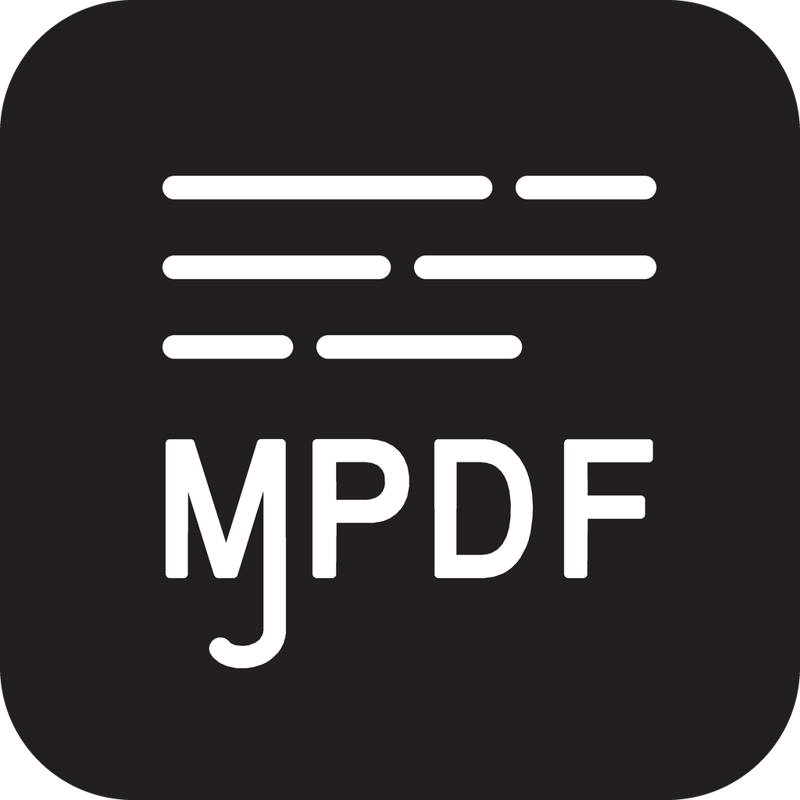
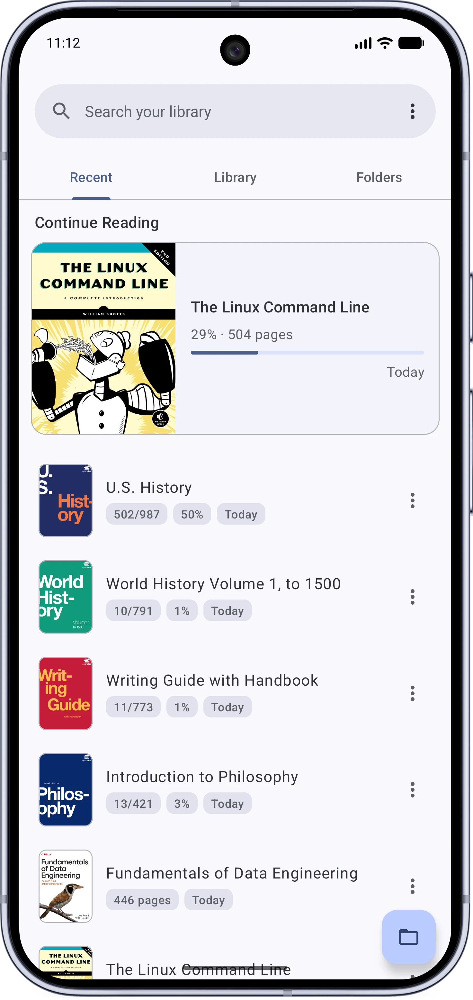
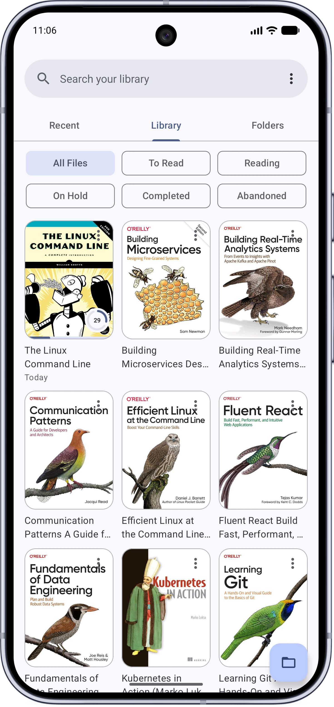
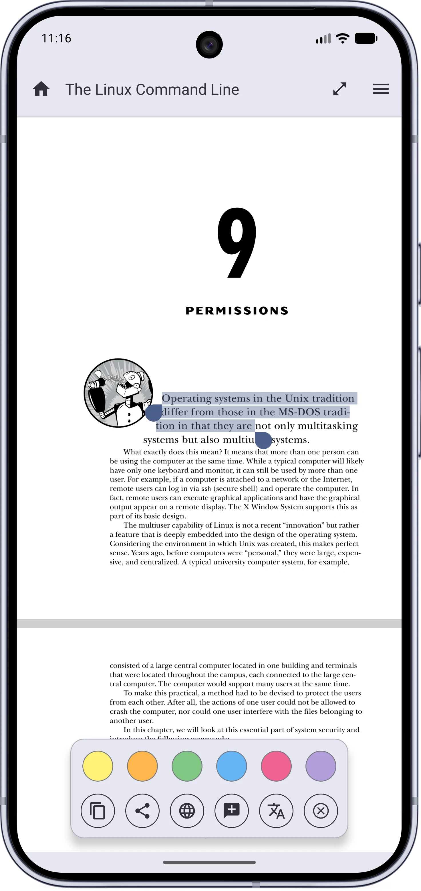
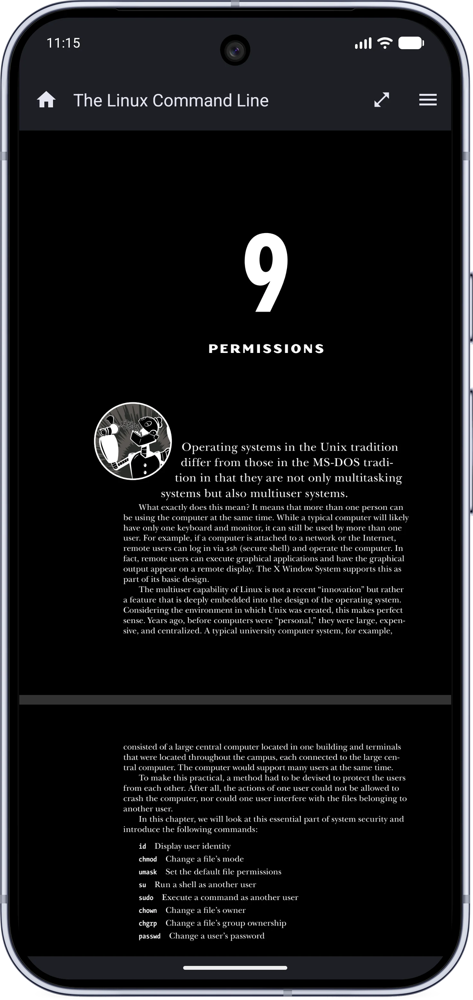
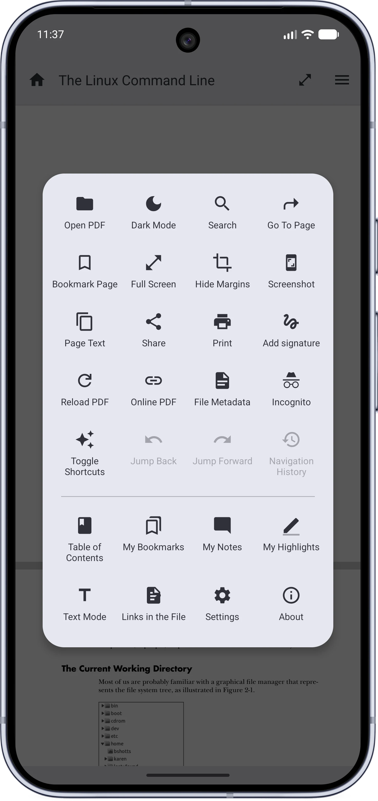
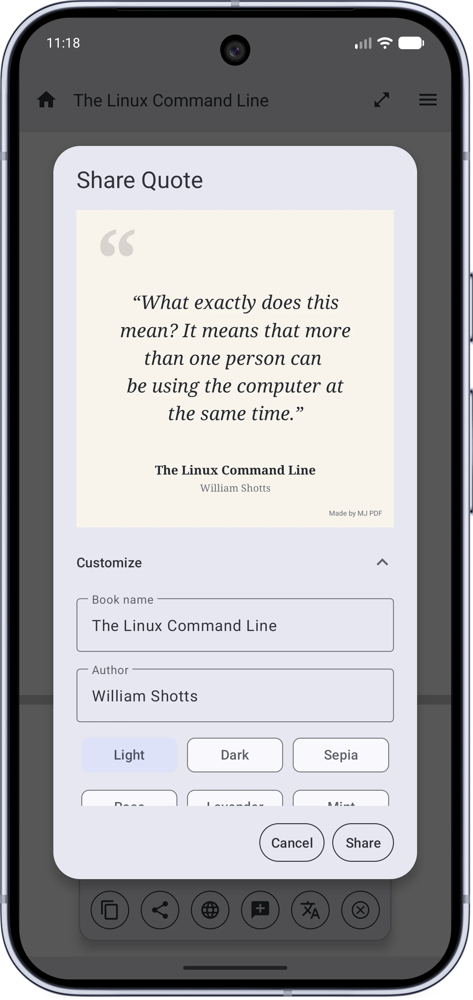

<div align="center">



**MJ PDF** is a fast, simple, powerful and totally private PDF reader made by [Mudlej](https://mudlej.com).

[](LICENSE)
[](change_log.md)
[](https://developer.android.com/about/versions/marshmallow)
[](https://play.google.com/store/apps/details?id=com.gitlab.mudlej.MjPdfReader)
[](https://f-droid.org/packages/com.gitlab.mudlej.MjPdfReader/)
[](https://apt.izzysoft.de/fdroid/index/apk/com.gitlab.mudlej.MjPdfReader)

</div>

<div align="center">

<a href="https://mudlej.com/projects/mj-pdf"></a>

<br/>

<a href="https://play.google.com/store/apps/details?id=com.gitlab.mudlej.MjPdfReader"></a>
<a href="https://f-droid.org/packages/com.gitlab.mudlej.MjPdfReader/"></a>
<a href="https://apt.izzysoft.de/fdroid/index/apk/com.gitlab.mudlej.MjPdfReader"></a>
<a href="https://mudlej.com/mj-pdf.apk"></a>
<a href="https://gitlab.com/mudlej_android/mj_pdf_reader"></a>
<a href="https://github.com/mudlej/mj_pdf/"></a>

</div>

## Screenshots
| Home | Library | Highlight & Select |
|:-:|:-:|:-:|
|  |  |  |
| **Dark Mode** | **Reader Menu** | **Share Quotes** |
|  |  |  |

More screenshots are in the [MJ PDF Gallery](http://mudlej.com/projects/mj-pdf/supplements/gallery/).

## What's new in 3.1
Version 3.1 is a correctness and stability release: a few new reading options, much safer saving and backups, and a long list of fixes.

- Single Page Mode shows one full page per screen and turns pages like a book, with taps on the screen edges flipping the page.
- Pick a page fit policy: fit pages by width, by height, or show the whole page.
- One Reading Mode setting gathers continuous, horizontal, single page, and dual page.
- Search happens without leaving the document, and results wrap around at both ends.
- Files shared by other apps ask before a copy is kept, or always keep one, your choice.
- Saving is far safer: every write is verified, failed saves keep a rescue copy, and saved files no longer grow.
- Documents are identified more reliably, so two similar files never share reading history.
- The theme toggle stays visible when the PDF theme follows the system, and lets you pick a theme on the spot.
- Dozens of fixes across search, gestures, backups, rotation, and right to left reading.

The full list is in the [changelog](change_log.md). Coming from 2.x? See what 3.0 added on the [v3.0 release page](http://mudlej.com/projects/mj-pdf/supplements/v3.0.0-release/).

## MJ PDF Features

**Library**
- Home screen with three tabs: Recent, Library, and Folders.
- Continue reading right where you left off, with a detailed reading history.
- Reading statuses: to-read, reading, on-hold, completed, abandoned.
- Cover grid or list view, with adjustable grid size and sorting.
- The Folders tab is a real file manager with breadcrumbs and SD-card support.
- Search every PDF on your device.
- Reading progress and statuses survive file moves and renames.

**Reader**
- Fast, simple, and very lightweight.
- Dark mode for the app and for the PDF itself.
- True full screen with configurable buttons, reading progress, time, and page info.
- Rotate, brightness bar, auto-scroll with adjustable speed, zoom lock, screenshots.
- Dual page mode that pairs pages like an open book.
- Single Page Mode and a page fit policy: by width, by height, or whole page.
- Hide PDF margins to make the page fill your screen.
- Right-to-left reading with automatic detection.
- Open password-protected PDFs and online PDFs through links.
- Share and print PDFs. Open multiple instances at the same time.
- Mouse wheel and mouse button support, volume-key page turning.

**Highlights, signatures, and forms**
- Highlight text and save the highlights into the PDF file.
- Attach notes to highlights, browse them in My Notes and My Highlights pages.
- Edit highlights that already exist in the document.
- Draw a handwritten signature once, reuse it anywhere, saved as sharp vector strokes.
- Fill PDF forms.
- Select text inline with copy, share, web-search, translate, and dictionary actions.
- Share quotes as images, with the book's name and a choice of themes.

**Search and navigation**
- Very fast and powerful search with live streaming results.
- Next and previous result navigation from inside the reader.
- A page for the full Table of Contents, with search.
- A page for all the links embedded in the PDF.
- User bookmarks with custom names and chapter context.
- Browser-like back and forward navigation history.

**Text Mode**
- Read any PDF like an e-book.
- Text reflow, multiple fonts, themes, and adjustable line length.

**Privacy**
- Open source with total privacy.
- No data collection, no ads, no tracking.
- Incognito mode that saves nothing about what you read.
- Shared files can be kept as private copies so they reopen reliably: always, or ask each time.

## Permissions and privacy
Your data stay on your device. MJ PDF has no ads or tracking of any kind.

If the app crashes, you can choose to send a technical report to help diagnose it. The report contains a stack trace, app version, crash time, package name, Android version, phone model, logcat, and available memory. It does not include your PDF documents and is **NEVER** sent without your approval.

Permissions:
- **Internet**: open PDFs from links and send crash reports only if you approve
- **All files access**: discover, open, rename, delete, and manage PDFs across device and removable storage

## How to build
```sh
git clone https://gitlab.com/mudlej_android/mj_pdf_reader.git
cd mj_pdf_reader
ANDROID_NDK=/path/to/android-ndk python3 build_dependencies.py
./gradlew assembleDebug
```

Native libraries are generated locally, not included in Git. Gradle packages them
but does not run the native dependency build automatically.

- To set up a build environment from a fresh Linux install, see [SETUP.md](SETUP.md).
- Use `build_dependencies.py` as the single native-build entrypoint. Add `--abi arm64-v8a` for one architecture or `--dry-run` to inspect the build without changing files.
- PDFium's pinned revision, Android build settings and local Arabic patches live together in [build_dependencies/patches/pdfium](build_dependencies/patches/pdfium/README.md). Source builds apply them automatically and refuse unexpected local source changes.
- After editing `mainJNILib.cpp`, run `ANDROID_NDK=/path/to/android-ndk python3 build_dependencies.py --native-only` to rebuild JNI using the existing dependency libraries.

The repository is three modules:

| Module | Role |
|---|---|
| `app` | The MJ PDF application |
| `AndroidPdfViewer` | MJ PDF's viewer library: rendering, gestures, text selection, highlights |
| `PdfiumAndroid` | MJ PDF's bindings to the PDFium engine |

## The test suite
MJ PDF is tested end to end on real Android, not mocked. The suite drives the actual app on emulators the way a person does: it taps, scrolls, rotates the screen, kills the process mid-task, swaps files underneath the reader, and then checks what ended up on screen, in the database and on disk.

- **1,463 end to end tests** in 353 classes, covering all 14 areas of the app:

  | Area | Tests | Area | Tests |
  |---|--:|---|--:|
  | History, settings and backup | 207 | Reader navigation | 98 |
  | Reader display and gestures | 155 | App entry and onboarding | 87 |
  | Home and library | 139 | Rendering and performance | 66 |
  | Annotations and forms | 116 | Localization and layout | 59 |
  | Text mode and selection | 114 | Document intake | 55 |
  | Saving and produced artifacts | 109 | Search | 52 |
  | Privacy and security | 105 | Reliability and resource use | 101 |

- **Android 9 to the newest release:** the suite runs on emulators at API 28, 33, 34, 35, 36 and 37, with both GPU and software rendering.
- **Generated fixtures:** 185 fixture PDFs come from scripts, byte for byte identical on every run. They range from malformed, encrypted and hostile files to Arabic text, huge documents and a 100,000-file library. One real book, [The Linux Command Line](https://linuxcommand.org/tlcl.php), anchors the rendering baselines.
- **Pixel checked rendering:** pages are compared against 62 reviewed golden screenshots.
- **Process death and restarts:** 12 multi-process scenarios kill the app mid-task, revoke storage access between runs or force a cold start, and check what survives.
- **A purpose built runner** in Python. It shards the suite across many emulators in parallel, balances them by test duration, and pins screen size, density, locale and time zone. It isolates every test with Android Test Orchestrator and fails a run that leaves files behind in shared storage.
- **1,142 JVM unit tests** underneath the screens, running in seconds without an emulator: 805 for the app, 306 for the viewer library and 31 for the PDFium bindings. They pin the decisions the E2E suite cannot reach one input at a time: page layout and coordinate math, the tile cache and render queue, crop margin detection, the backup codec and import validation, document identity hashing, search snippets, text mode reflow, reader history, settings search and the Arabic text normalization. 57 of them document suspected bugs that await a decision and are skipped until then. See [testing/jvm-tests.md](testing/jvm-tests.md).
- **More layers of tests:** 19 macrobenchmarks, 28 PDFium C++ tests for MJ PDF's own engine patches, and 258 tests for the runner and the build tooling.

The full suite passed five times in a row on ten emulators, with zero failures.

To run it:
```sh
python3 testing/fixtures/generate.py
python3 testing/runner/run.py
```
The second command opens an interactive setup for picking emulators and areas. See [testing/runner/README.md](testing/runner/README.md) for running single classes, multi-process scenarios and every option.

## Code size
Lines of code at each layer of MJ PDF, from the app down to the PDF engine, as of November 2026:

| Layer | Language | Code | Tests | Total |
|---|---|--:|--:|--:|
| App | Kotlin | 35,500 | 104,148 | 139,648 |
| Viewer library | Java | 11,535 | 5,049 | 16,584 |
| PDFium bindings | Java, C++ | 3,782 | 296 | 4,078 |
| PDFium patches | C++ | 1,476 | 1,415 | 2,891 |
| **Total** | | **52,293** | **110,908** | **163,201** |

The tooling around them adds 21,906 more lines, mostly Python: 19,902 for the test runner and fixture generators, and 2,004 for the native build and its tests. That's 185,107 lines in all.

Counts are non-blank, non-comment lines in the repository. They leave out upstream PDFium and its public headers, and the PDFium patches count only the lines they add.

## Contributing
- **Bugs and requests**: open an issue on [GitLab](https://gitlab.com/mudlej_android/mj_pdf_reader/-/issues). If you do not have a GitLab account, use the [GitHub mirror](https://github.com/mudlej/mj_pdf/).
- **Translations**: MJ PDF is available in 15 languages: Arabic, Chinese, Dutch, English, French, German, Hindi, Italian, Persian, Polish, Portuguese (Brazil), Russian, Spanish, Ukrainian and Turkish. To add or improve one, edit `app/src/main/res/values-<lang>/strings.xml` and open a merge request.

## Authors and acknowledgment
- MJ PDF is made by [Mudlej](https://mudlej.com). The full story is on the [official page](https://mudlej.com/projects/mj-pdf).
- MJ PDF v1 and v2 were based on PDF Viewer Plus by Gokul Swaminathan ([@JavaCafe01](https://github.com/JavaCafe01)), who discontinued his app and recommended MJ PDF as its replacement. The app in v3.0.0 since been entirely rewritten.
- [@barteksc](https://github.com/barteksc) wrote the original viewer and PDFium binding libraries that MJ PDF's PDF stack grew from.
- Credits to [@Derekelkins](https://github.com/Derekelkins) for adding the ability to remember the last opened page to the original app.
- Big thanks to [Bnyro](https://gitlab.com/Bnyro) (LibreTube's dev) for helping me with the colors and the migration to M3. (MJ PDF v2.1)
- Community translators brought the app to 15 languages.
- The test suite renders [The Linux Command Line](https://linuxcommand.org/tlcl.php) by William Shotts as a real world PDF fixture.

## License
MJ PDF uses the GPLv3 license. The original app (PDF Viewer Plus) was under the MIT license.
